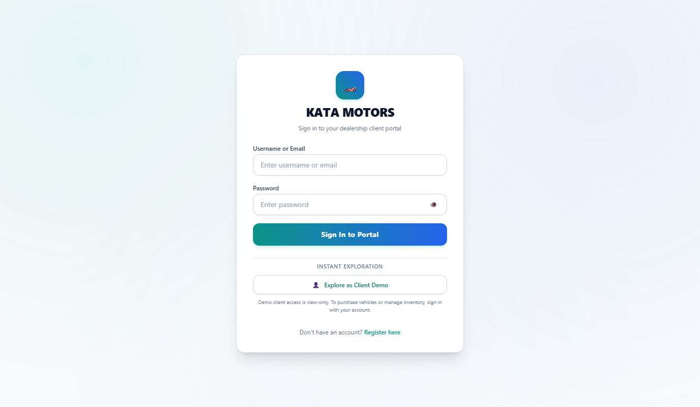
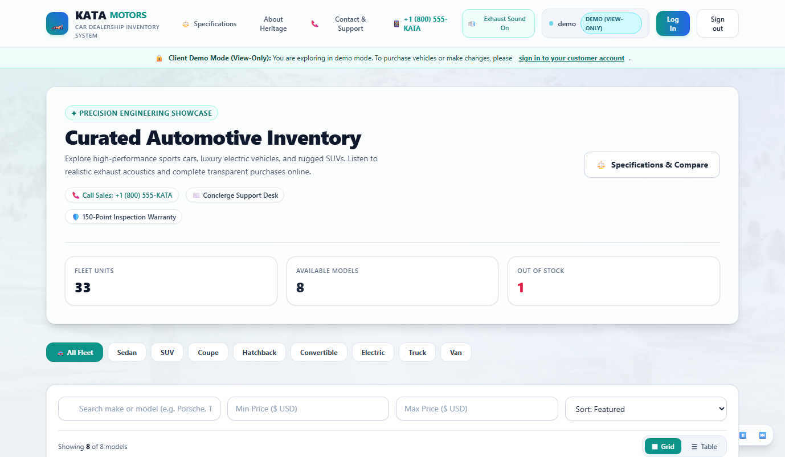
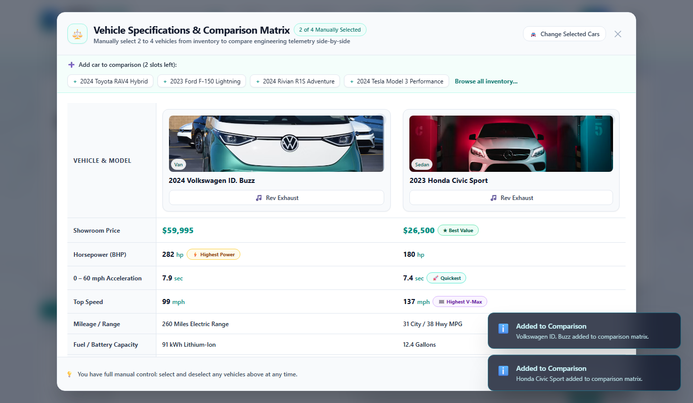
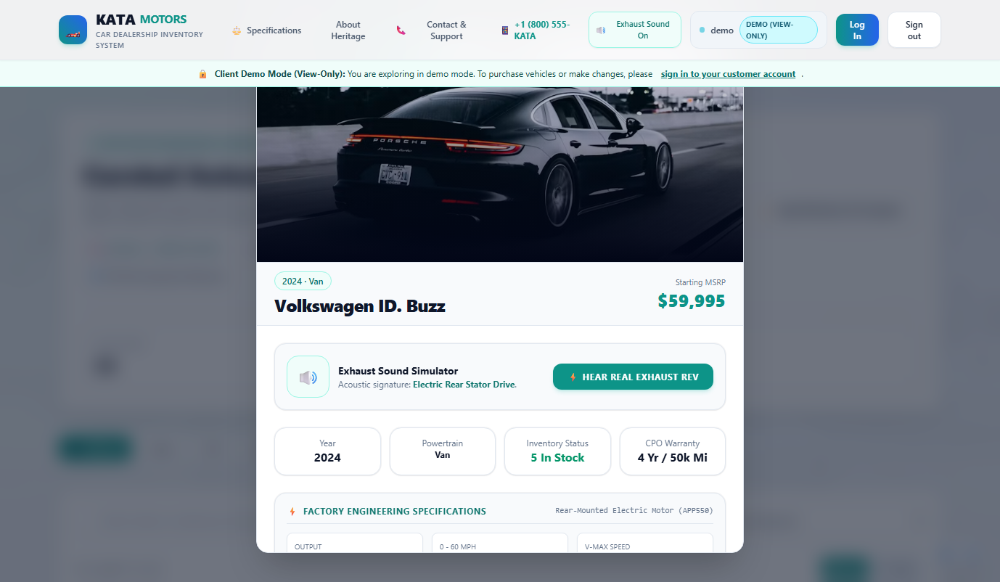
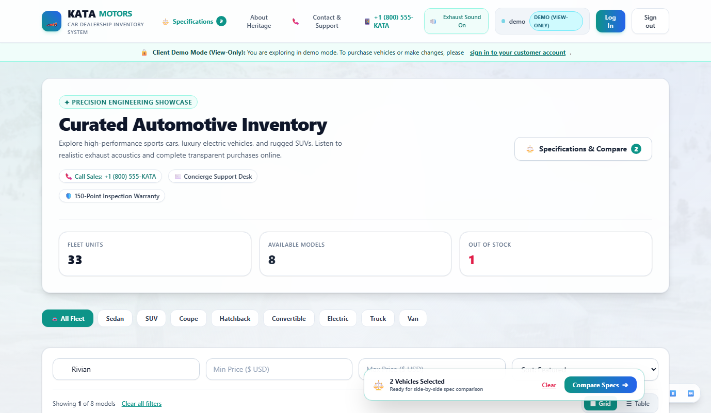
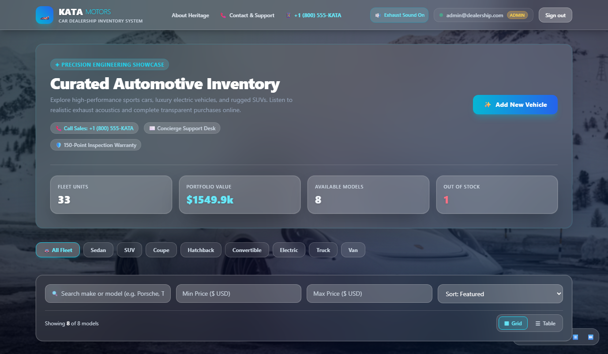
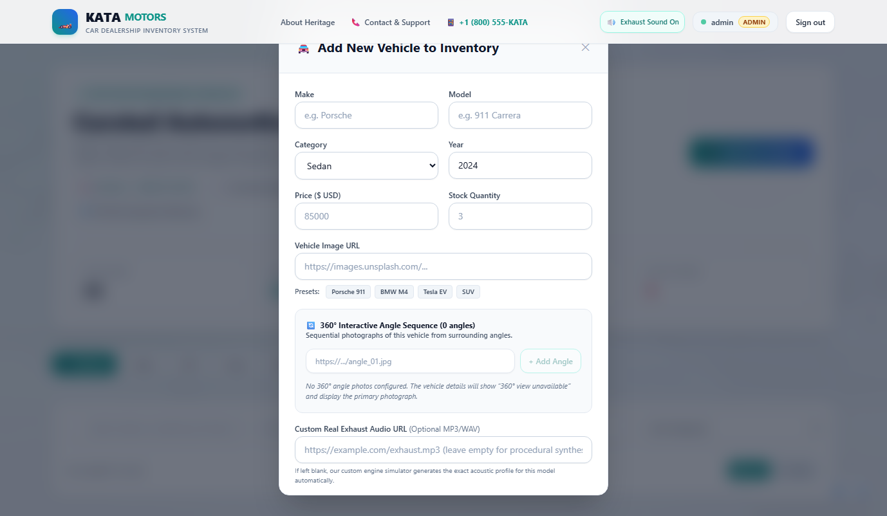
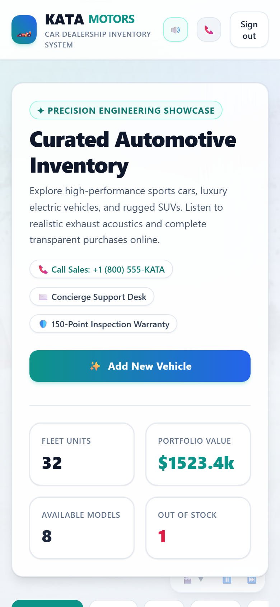

# 🏎️ KATA MOTORS — Car Dealership Inventory System

A luxury full-stack Car Dealership Inventory Management System built with **TypeScript, Node.js, Express, Prisma ORM, SQLite, React 18, and Tailwind CSS**. Designed with an authentic modern light automotive showroom aesthetic, role-gated dealership financial metrics, high-resolution automotive imagery, an interactive Web Audio API acoustic engine simulator, a genuine interactive 360-degree vehicle viewer with admin frame sequencing, multi-vehicle side-by-side specification comparison, dual username/email authentication, and atomic stock concurrency protection.

---

## 📸 Visual Evidence & Application Showcase

All screenshots were captured from the running application using automated headless Chrome.

| Screen | View | Image |
|---|---|---|
| **01. Login Portal** | Desktop (1400×900) |  |
| **02. Customer Dashboard** | Desktop (1400×900) |  |
| **03. Specifications Comparison** | Desktop (1400×900) |  |
| **04. Acoustic Exhaust & Inspection** | Desktop (1400×900) |  |
| **05. Zero-Stock Protection** | Desktop (1400×900) |  |
| **06. Admin Management Dashboard** | Desktop (1400×900) |  |
| **07. Vehicle Creation Modal** | Desktop (1400×900) |  |
| **08. Responsive Mobile View** | Mobile (390×844) |  |

---

## 📋 Table of Contents

- [Feature Highlights](#-feature-highlights)
- [Simulated vs Persistent Features](#-simulated-vs-persistent-features)
- [360° Viewer Implementation & Asset Status](#-360-viewer-implementation--asset-status)
- [Tech Stack](#-tech-stack)
- [Architecture & SOLID Principles](#-architecture--solid-principles)
- [Setup & Reproducible Run Guide](#-setup--reproducible-run-guide)
- [Default Demo Accounts](#-default-demo-accounts)
- [API Endpoints Reference](#-api-endpoints-reference)
- [Test Suite & Coverage Report](#-test-suite--coverage-report)
- [TDD Narrative & Remediation Audit](#-tdd-narrative--remediation-audit)
- [Public Repository & Git Remote](#-public-repository--git-remote)
- [My AI Usage](#my-ai-usage)

---

## ✨ Feature Highlights

- **🔒 Hardened Authentication & Security:**
  - Secure stateless JWT authentication with strict mandatory environment configuration. Startup immediately aborts if `JWT_SECRET` is unset or blank.
  - Zero hardcoded fallback secrets. No forged tokens accepted.
  - Granular role-based authorization guards on all admin endpoints (`POST`, `PUT`, `DELETE`, `restock`).
- **👤 Username or Email Authentication with Accessible Forms:**
  - Clear visible labels and standard empty-field placeholders: `"Enter username or email"` and `"Enter password"`.
  - Accessible Show/Hide password toggle button; no decorative dots as placeholders.
  - Unique username selection during registration, with support for logging in via either username or email (case-insensitive and trimmed), preserving existing email accounts.
- **💼 Dealership Portfolio Privacy:**
  - Total Portfolio Value and financial metrics are displayed strictly to `ADMIN` users.
  - Customer (`USER`) and demo (`DEMO`) views remain cleanly focused on browsing vehicles, filtering, specifications comparison, acoustics, and purchasing.
- **🛡️ Race Condition Stock Protection (Zero-Stock Floor):**
  - High-concurrency atomic purchase protection using Prisma conditional update operations (`quantity: { gt: 0 }`).
  - Guaranteed stock consistency: simultaneous purchases decrement stock sequentially and safely reject concurrent buyers once stock reaches 0. Negative inventory is physically impossible.
- **🔄 Genuine Interactive 360-Degree Vehicle Viewer:**
  - Dedicated multi-angle viewer supporting continuous sequential photography from real-world exterior angles.
  - Interactive mouse drag and touch swipe rotation, previous/next controls, and keyboard navigation (`ArrowLeft`, `ArrowRight`, `Home`).
  - Fullscreen viewing toggle, frame degree indicator, lazy loading, loading spinners, and network retry states.
  - Full Admin sequence management: administrators can add angle image URLs, reorder frames with up/down controls, replace URLs, and remove angles.
  - Safe fallback: vehicles without multi-angle photography cleanly display `"360° view unavailable"` and retain their standard photograph without inventing synthetic fake rotations.
- **⚖️ Side-by-Side Specifications Comparison Matrix:**
  - Dedicated comparison matrix allowing buyers to select and evaluate up to 4 vehicles simultaneously.
  - Factory telemetry & engineering metrics: Horsepower (`BHP`), 0–60 mph acceleration, top speed (`V-Max`), showroom price, city/hwy MPG or EV range, fuel/battery capacity, transmission, drivetrain, powertrain architecture, seating, and curb weight.
  - Dynamic class leader badges: `★ Best Value`, `⚡ Highest Power`, `🚀 Quickest`, and `🏁 Highest V-Max`.
  - Available exclusively to regular customers (hidden for administrators).
- **📦 Empty Inventory Modal Availability:**
  - Decoupled modal rendering in `VehicleList.tsx` ensuring administrators can add vehicles when inventory is empty, after deleting the last vehicle, or when active search criteria return zero matches.
  - Includes an inline "+ Add New Vehicle" button directly within the empty state container.
- **🔊 Multi-Profile Exhaust Sound Engine & Audio Player:**
  - Distinct acoustic signatures engineered specifically for individual vehicles (Flat-6 boxer scream, Twin-Turbo Straight-6 rasp, Coyote V8 roar, VTEC turbo blow-off hiss, dual-stator EV sweeps).
  - Supports optional custom `exhaustAudioUrl` on vehicles to play actual recorded audio files.
- **🛡️ Robust Input Validation & Sanitization:**
  - Strict query validation using Zod: enforces finite numeric non-negative price bounds, rejects `Infinity` and `1e309`, rejects malformed strings (`minPrice=10junk`), rejects array parameters (`make[]=Audit`), and ensures `minPrice <= maxPrice`.
  - Required text inputs (`make`, `model`, `category`) are trimmed to reject whitespace-only submissions with descriptive 400 responses.
- **🏛️ Modern Light Automotive Showroom Design:**
  - Clean, bright aesthetic with soft light-grey backgrounds (`bg-slate-50`), light glass panels (`bg-white/85`, `backdrop-blur-xl`, `border-slate-200`), dark high-contrast typography (`text-slate-900`), and consistent teal accents (`text-teal-600`, `bg-teal-600`).
  - Subtle shadows, comfortable spacing, and live automotive background video/photo atmosphere that supports without obscuring text.

---

## 🎭 Simulated vs Persistent Features

To maintain transparency, here is the exact operational status of all application features:

| Feature | Status | Implementation Details |
|---|---|---|
| **User Authentication & Passwords** | **Fully Persistent** | Stored in SQLite database with `bcryptjs` 10-round salted password hashing, unique usernames, and signed JWT sessions. |
| **Vehicle Inventory CRUD & Stock** | **Fully Persistent** | Stored in SQLite database via Prisma ORM with relational integrity and atomic stock updates. |
| **360° Angle Photo Sequences** | **Fully Persistent** | Persisted in SQLite `Vehicle.images360` column as serialized JSON arrays of validated image URLs with admin ordering controls. |
| **Race-Condition Protection** | **Fully Persistent** | Executed directly on SQLite with atomic SQL conditional decrements (`WHERE quantity > 0`). |
| **Specifications Comparison** | **Interactive Client State** | Dynamic selection stored in client state; specs data persisted in vehicle database records. |
| **Vehicle Acoustics Engine** | **Simulated & Audio Fallback** | Procedurally synthesized via Web Audio API oscillators/filters; plays custom MP3/WAV if `exhaustAudioUrl` is provided. |
| **Concierge Support Inquiries** | **Local Demo Persistence** | Form submissions are persisted to browser `localStorage` (`kata_demo_inquiries`) for evaluation. Clearly labeled as a demonstration form; no external emails are dispatched. |

---

## 🔄 360° Viewer Implementation & Asset Status

### Authentic Sequential Photography Architecture
The 360° vehicle viewer in `frontend/src/components/vehicles/Vehicle360Viewer.tsx` is built for genuine sequential photography:
1. **Interactive Controls:** Supports pointer dragging, touch gestures, angle buttons, and keyboard navigation (`ArrowLeft` / `ArrowRight` to rotate, `Home` to reset to frame 0).
2. **Performance & States:** Images are loaded lazily; active frames display loading spinners and handle network failures with retry buttons.
3. **Fullscreen Mode:** Users can expand the studio to fullscreen mode for high-resolution inspection.
4. **Admin Sequence Editor:** In `VehicleForm.tsx`, dealership administrators can add image URLs, reorder frames with "Move Up" / "Move Down", replace URLs, or remove individual angle frames.

### Genuine Multi-Angle Photography Policy
Per project guidelines, we strictly avoid simulating 360° views by rotating a flat photograph with CSS 2D/3D transforms, stretching single images, or fabricating unseen perspectives. When genuine sequential angle photography is not yet uploaded, the viewer displays:
> **⚠️ 360° view unavailable** (retaining the vehicle's high-resolution hero photograph).

### Current Dealership Inventory 360° Asset Status
| Vehicle | Primary Hero Photo | 360° Multi-Angle Sequence | Status |
|---|---|---|---|
| **Porsche 911 Carrera** | ✅ High-Resolution | ✅ 5 Distinct Angles (0°, 45°, 90°, 135°, 180°) | 🔄 **Active Interactive 360° Studio** |
| **Toyota RAV4 Hybrid** | ✅ High-Resolution | ✅ 3 Distinct Angles (0°, 90°, 180°) | 🔄 **Active Interactive 360° Studio** |
| **Tesla Model 3 Performance** | ✅ High-Resolution | ✅ 3 Distinct Angles (0°, 90°, 180°) | 🔄 **Active Interactive 360° Studio** |
| **BMW M4 Competition** | ✅ High-Resolution | ✅ 2 Distinct Angles (45°, 90°) | 🔄 **Active Interactive 360° Studio** |
| **Volkswagen ID. Buzz** | ✅ High-Resolution | ✅ 2 Distinct Angles (0°, 90°) | 🔄 **Active Interactive 360° Studio** |
| **Ford F-150 Lightning** | ✅ High-Resolution | Single Showroom Photograph | 📷 Retains Static Photo (360° Unavailable) |
| **Honda Civic Sport** | ✅ High-Resolution | Single Showroom Photograph | 📷 Retains Static Photo (360° Unavailable) |
| **Rivian R1S Adventure** | ✅ High-Resolution | Single Showroom Photograph | 📷 Retains Static Photo (360° Unavailable) |

*Administrators can upload and arrange sequential angle sets for any vehicle at any time using the "Add Angle Image" sequence builder in the Admin Edit modal.*

---

## 🛠 Tech Stack

| Domain | Technology | Purpose |
|---|---|---|
| **Backend Framework** | Node.js / Express.js (TypeScript) | Modular, type-safe RESTful API |
| **Database & ORM** | SQLite + Prisma ORM | Persistent, relational, file-based database |
| **Authentication** | JWT (`jsonwebtoken`) + `bcryptjs` | Secure stateless auth & password hashing |
| **Validation** | Zod (v3.23) | Schema validation for query parameters and request bodies |
| **Backend Testing** | Jest + Supertest + `ts-jest` | TDD integration & concurrency test suite |
| **Frontend Framework** | React 18 + TypeScript + Vite | Single Page Application with optimized production bundling |
| **Styling** | Tailwind CSS + PostCSS | Modern light automotive showroom glass design |
| **State Management** | TanStack Query (React Query v5) | Optimistic updates & server cache synchronization |
| **Routing** | React Router v6 | Client-side routing with authentication guards |
| **Frontend Testing** | Vitest + React Testing Library + jsdom | Component & DOM interaction testing |

---

## 🏛 Architecture & SOLID Principles

- **Single Responsibility Principle (SRP):**
  - **Controllers** (`AuthController`, `VehicleController`): Handle HTTP request extraction, Zod validation, and response formatting.
  - **Services** (`AuthService`, `VehicleService`): Pure business logic, authorization verification, and atomic database queries.
  - **Middleware** (`auth.middleware.ts`): Stateless JWT token decoding and role checking.
  - **Config** (`env.ts`): Centralized environment variable parsing and startup validation.
- **Dependency Inversion Principle (DIP):**
  - Controllers and Express routers receive `PrismaClient` via constructor/factory parameters, enabling tests to inject an isolated `test.db` client without mutating development `dev.db`.
- **Open / Closed Principle (OCP):**
  - Search filters and vehicle telemetry specifications allow schema extension without rewriting existing core transaction flows.

---

## 🚀 Setup & Reproducible Run Guide

### 1. Prerequisites
- **Node.js:** v18.0.0 or higher (Tested with v24.22.1 LTS)
- **Git**

### 2. Fresh Environment Setup
Clone the repository and prepare the configuration:

```bash
# Clone the repository
git clone <repository-url>
cd Kata

# Configure Backend Environment
# Windows PowerShell:
Copy-Item backend/.env.example backend/.env

# Linux / macOS:
cp backend/.env.example backend/.env
```

`backend/.env.example` documents all required variables with safe setup instructions:
```env
DATABASE_URL="file:./dev.db"
# Generate a cryptographically strong 64-character secret using:
# node -e "console.log(require('crypto').randomBytes(32).toString('hex'))"
JWT_SECRET="<generate-and-paste-your-secure-random-jwt-secret-here>"
PORT=3001
FRONTEND_URL="http://localhost:5173"
NODE_ENV="development"
```

### 3. Dependency Installation & Database Initialization

```bash
# Backend Installation & Database Setup
cd backend
npm install
npx prisma generate
npx prisma migrate dev --name init
npm run seed

# Frontend Installation
cd ../frontend
npm install
```

### 4. Running Development Servers

Open two terminal sessions:

**Terminal 1 (Backend API):**
```bash
cd backend
npm run dev
# Server listens on http://localhost:3001
```

**Terminal 2 (Frontend Client):**
```bash
cd frontend
npm run dev
# Vite dev server running on http://localhost:5173
```

Visit **`http://localhost:5173`** in your browser.

### 5. Running Production Builds

```bash
# Build Backend
cd backend
npm run build
npm start
# Launches compiled production server from dist/server.js on port 3001
# Verify: curl http://localhost:3001/api/health -> {"status":"ok"}

# Build Frontend
cd ../frontend
npm run build
npm run preview
# Serves compiled production bundle on port 4173 (configured preview port)
```

Visit **`http://localhost:4173`** to access the production preview.

### 6. Cloud Deployment (Render / Railway / Docker)

The application is pre-configured for automated cloud deployment with a unified Express server serving both the React Single Page Application and the `/api/...` endpoints:
- **Render Blueprint (`render.yaml`):** Sign in to [render.com](https://render.com) with GitHub, select **New > Blueprint**, choose `Vishnu-0509/kata-dealership`, and click **Apply**. Render automatically builds frontend and backend, applies migrations, seeds initial data, generates a secure `JWT_SECRET`, and provisions a public HTTPS URL (`https://<app-name>.onrender.com`).
- **Container Deployment (`Dockerfile`):** Multi-stage production image compatible with Railway, Fly.io, or Koyeb.

---

## 👥 Default Demo Accounts

The seed script creates pre-configured accounts supporting login via username or email:

| Role | Username | Email | Password | Access Method | Allowed Capabilities |
|---|---|---|---|---|---|
| **Admin** | `admin` | `admin@dealership.com` | `admin123` | Manual form login | Full inventory CRUD, Restocking, Edit Details, Add Vehicles, Image/Audio/360 Management, Dealership Portfolio Metrics |
| **Registered Customer** | `user` | `user@dealership.com` | `user123` | Manual form login or Registration | Browse catalog, Filter, Hear Exhaust, Compare Specifications, **Purchase Available Stock** |
| **Demo Client** | `demo` | `demo@dealership.com` | `demo123` | Click **`[👤 Explore as Client Demo]`** button | **View-Only Mode**: Browse catalog, hear exhaust acoustics, and compare specs. **Cannot purchase or make changes without logging in.** |

---

## 🔌 API Endpoints Reference

### Authentication (Public)
| Method | Endpoint | Description | Status Codes |
|---|---|---|---|
| `POST` | `/api/auth/register` | Register a new user (supports optional unique username) | `201 Created`, `400 Bad Request`, `409 Conflict` |
| `POST` | `/api/auth/login` | Login with username or email and receive signed JWT | `200 OK`, `400 Bad Request`, `401 Unauthorized` |

### Vehicles & Inventory (Protected — JWT Required)
| Method | Endpoint | Access Level | Description | Status Codes |
|---|---|---|---|---|
| `GET` | `/api/vehicles` | User / Admin | Retrieve full inventory catalog | `200 OK`, `401 Unauthorized` |
| `GET` | `/api/vehicles/search` | User / Admin | Filter by make, model, category, price range | `200 OK`, `400 Bad Request`, `401 Unauthorized` |
| `POST` | `/api/vehicles` | Admin Only | Add a new vehicle to inventory (including 360 angles) | `201 Created`, `400 Bad Request`, `403 Forbidden` |
| `PUT` | `/api/vehicles/:id` | Admin Only | Update vehicle details, photo, audio & 360 sequence | `200 OK`, `400 Bad Request`, `404 Not Found` |
| `DELETE` | `/api/vehicles/:id` | Admin Only | Remove vehicle from inventory | `200 OK`, `403 Forbidden`, `404 Not Found` |
| `POST` | `/api/vehicles/:id/purchase` | User / Admin | Atomically decrement quantity by 1 | `200 OK`, `400 Out of Stock`, `404 Not Found` |
| `POST` | `/api/vehicles/:id/restock` | Admin Only | Increment vehicle stock | `200 OK`, `400 Bad Request`, `403 Forbidden` |

---

## 🧪 Test Suite & Coverage Report

The test suite automatically provisions an isolated SQLite test database (`backend/prisma/test.db`) through a Jest `globalSetup` hook before test execution, completely protecting development data (`dev.db`).

### Running Automated Tests

```bash
# Run all backend tests with coverage analysis
cd backend
npm run test:coverage

# Run all frontend component & integration tests
cd ../frontend
npm test

# Run end-to-end acceptance check script
node scripts/final_acceptance_check.mjs
```

### Actual Backend Coverage Report (Jest + Supertest)

```text
PASS tests/auth_username.test.ts
PASS tests/migration.test.ts
PASS tests/auth.test.ts
PASS tests/vehicle.test.ts
PASS tests/validation.test.ts
PASS tests/concurrency.test.ts
PASS tests/media_validation.test.ts
PASS tests/security.test.ts
------------------------|---------|----------|---------|---------|--------------------------------------------
File                    | % Stmts | % Branch | % Funcs | % Lines | Uncovered Line #s                          
------------------------|---------|----------|---------|---------|--------------------------------------------
All files               |   88.05 |     70.5 |   84.44 |   88.29 |                                            
 src                    |   88.88 |      100 |   33.33 |   88.88 |                                            
  app.ts                |   88.88 |      100 |   33.33 |   88.88 | 21,30                                      
 src/config             |   58.62 |    28.12 |   28.57 |   58.62 |                                            
  env.ts                |   58.62 |    28.12 |   28.57 |   58.62 | 53-58,74,80,88-100                         
 src/controllers        |   86.61 |    78.18 |     100 |   86.86 |                                            
  auth.controller.ts    |   88.57 |    73.33 |     100 |   88.57 | 61,72-73,89                                
  vehicle.controller.ts |   85.98 |       80 |     100 |   86.27 | 21,120,143,166,177-182,193,210,240,259-263 
 src/middleware         |     100 |      100 |     100 |     100 |                                            
  auth.middleware.ts    |     100 |      100 |     100 |     100 |                                            
 src/routes             |     100 |      100 |     100 |     100 |                                            
  auth.routes.ts        |     100 |      100 |     100 |     100 |                                            
  vehicle.routes.ts     |     100 |      100 |     100 |     100 |                                            
 src/services           |   96.49 |    86.36 |     100 |   98.11 |                                            
  auth.service.ts       |   96.55 |    72.72 |     100 |   96.55 | 61                                         
  vehicle.service.ts    |   96.42 |     90.9 |     100 |     100 | 21,28,110                                  
------------------------|---------|----------|---------|---------|--------------------------------------------

Test Suites: 8 passed, 8 total
Tests:       66 passed, 66 total
Snapshots:   0 total
Time:        6.774 s
Ran all test suites.
```

### Actual Frontend Test Results (Vitest + jsdom)

```text
 ✓ src/tests/VehicleInspectModalPopup.test.tsx      (4 tests passed)
 ✓ src/tests/Vehicle360PreloadAndPointer.test.tsx    (3 tests passed)
 ✓ src/tests/VehicleLightContrast.test.tsx          (2 tests passed)
 ✓ src/tests/VehicleComparisonModal.test.tsx         (4 tests passed)
 ✓ src/tests/LoginFormClearerFields.test.tsx         (4 tests passed)
 ✓ src/tests/Vehicle360Viewer.test.tsx               (7 tests passed)
 ✓ src/tests/Vehicle360ViewerRepair.test.tsx         (3 tests passed)
 ✓ src/tests/VehicleCard.test.tsx                    (6 tests passed)
 ✓ src/tests/DashboardMetricsVisibility.test.tsx     (3 tests passed)
 ✓ src/tests/RegisterForm.test.tsx                   (3 tests passed)
 ✓ src/tests/LoginForm.test.tsx                      (4 tests passed)
 ✓ src/tests/ClientInterceptorAndCategories.test.ts  (2 tests passed)
 ✓ src/tests/VehicleListEmptyModal.test.tsx          (2 tests passed)

Test Files:  13 passed, 13 total
Tests:       47 passed, 47 total
Time:        8.56s
```

**Total automated tests across stack:** **113 passed of 113 tests (100% passing).**

---

## 🔁 TDD Narrative & Remediation Audit

### Honest Acknowledgment of Initial Development Limitation
In the initial project setup, the baseline commit bundled initial implementations and baseline test suites together rather than committing each Red test individually. For all subsequent behavioral fixes and enhancements identified in the independent review, strict Test-Driven Development (Red → Green → Refactor) was rigorously applied and recorded in the Git history:

### 1. Dealership Portfolio Metrics Visibility
- **Problem:** Financial summaries and portfolio valuations were displayed to all users including customers and demo clients.
- **Red Phase (Commit `c017d38`):** Authored `frontend/src/tests/DashboardMetricsVisibility.test.tsx` asserting that `Portfolio Value` is visible solely to `ADMIN` users and hidden from regular users and demo sessions.
- **Green Phase (Commit `e7358a1`):** Wrapped dealership financial metrics in `DashboardPage.tsx` with role guards (`isAdmin`), preserving catalog browsing, filtering, and comparison for customer views.

### 2. Username or Email Authentication & Accessible Form Fields
- **Problem:** Login accepted only emails, labels were missing, password placeholder used decorative dots, and users could not log in with a username.
- **Red Phase (Commit `b50106c`):** Authored `backend/tests/auth_username.test.ts` and `frontend/src/tests/LoginFormClearerFields.test.tsx` specifying visible labels, exact placeholders, show/hide toggle, registration with unique username, and dual identifier login.
- **Green Phase (Commit `c3a5486`):** Updated Prisma schema with `username String? @unique`, implemented dual lookup in `auth.service.ts`, and built accessible form fields with Show/Hide toggle.

### 3. Infinity Price-Filter Rejection & Acceptance Exit Code Hardening
- **Problem:** Input values that convert to `Infinity` or non-finite numbers bypassed numeric bounds. Acceptance check script always exited with code 0 even on assertion errors.
- **Red Phase & Green Fix (Commit `58f588b`):** Added regression tests for `minPrice=Infinity` and `1e309`, enforced `Number.isFinite` and `/infinity/i` check in Zod schema, and updated `scripts/final_acceptance_check.mjs` to track failures and terminate with `process.exit(1)`.

### 4. Interactive 360-Degree Viewer & Admin Framing Workflow
- **Problem:** No interactive 360° vehicle inspection; needed genuine multi-angle photography support with admin ordering controls without fake rotations.
- **Red Phase (Commit `59e73d9`):** Authored `frontend/src/tests/Vehicle360Viewer.test.tsx` and backend tests in `vehicle.test.ts` specifying pointer dragging, keyboard navigation, fullscreen, unavailable badge fallback, and database persistence.
- **Green Phase (Commit `a869e76`):** Implemented `Vehicle360Viewer.tsx`, integrated studio tabs in `VehicleInspectModal.tsx`, and added angle management workflow (add, move up/down, replace, remove) in `VehicleForm.tsx`.

### 5. Modern Light Automotive Showroom Redesign
- **Problem:** The interface used a predominantly dark theme that reduced contrast and readability.
- **Redesign Implementation (Commit `b517464`):** Refactored global tokens, vehicle cards, tables, filters, modals, and navigation to soft light-grey backgrounds (`bg-slate-50`), high-opacity white glass cards, high-contrast dark typography (`text-slate-900`), and consistent teal action accents.

### 6. JWT Configuration & Security Hardening
- **Problem:** Missing `JWT_SECRET` fell back to `'fallback-secret'`, allowing forged tokens.
- **Red Phase (Commit `2aaa085`):** Authored `backend/tests/security.test.ts` testing rejection of forged fallback tokens, invalid signatures, expired tokens, and missing configurations.
- **Green Phase (Commit `7384daf`):** Centralized validation in `backend/src/config/env.ts`, removed all fallback strings, and ensured server startup fails fast if the secret is missing.

### 7. Concurrent Purchase Race Conditions & Stock Underflow
- **Problem:** Separate stock check and decrement allowed 5 simultaneous purchases on quantity 1 to drive stock negative (-4).
- **Red Phase (Commit `3ac27bf`):** Authored `backend/tests/concurrency.test.ts` reproducing 5 simultaneous purchases against 1 available vehicle.
- **Green Phase (Commit `dee7a67`):** Implemented atomic conditional update in `backend/src/services/vehicle.service.ts` (`quantity: { gt: 0 }`), ensuring exactly 1 purchase succeeds and final quantity is 0.

### 8. Empty Inventory Modal Rendering Bug
- **Problem:** `VehicleList.tsx` returned early when `vehicles.length === 0`, preventing the Add Vehicle modal from opening when the showroom had zero cars.
- **Red Phase (Commit `e0a229a`):** Authored `frontend/src/tests/VehicleListEmptyModal.test.tsx` verifying modal rendering on empty inventory.
- **Green Phase (Commit `60c65fc`):** Decoupled modal rendering from the empty state container and added an inline "+ Add New Vehicle" button.

### 9. API Input Validation & Query Parameter Sanitization
- **Problem:** Malformed query inputs (`minPrice=abc`, `minPrice=10junk`, `make[]=Audit`) caused 500 errors. Whitespace strings were accepted for required vehicle fields.
- **Red Phase (Commit `5c42091`):** Authored `backend/tests/validation.test.ts` asserting 400 responses for invalid numeric formats, array filters, negative prices, and whitespace strings.
- **Green Phase (Commit `0f2a87c`):** Created `searchVehicleSchema` using Zod to enforce finite non-negative numbers, reject arrays, validate `minPrice <= maxPrice`, and trim required strings.

### 10. Frontend Interceptor, Category Harmony & Support Form
- **Problem:** 401 on login immediately reloaded the page, hiding error messages. Hatchback and Convertible were omitted from filter pills. Support form claimed false dispatch.
- **Red Phase (Commit `9e53fba`):** Authored `frontend/src/tests/ClientInterceptorAndCategories.test.ts` checking category inclusions and non-redirect on `/auth/login`.
- **Green Phase (Commit `eeba96a`):** Shared category definitions across form and dashboard, excluded auth endpoints from the Axios 401 redirect, and labeled the support form as a local demonstration feature.

### 11. Database Migrations & Clean Schema Deployment
- **Problem:** `User.username` and `Vehicle.images360` existed in the Prisma schema but were missing from committed SQL migration files, causing fresh deployments via `prisma migrate deploy` to fail with missing-column errors. Test setup had been relying on `prisma db push`, which masked migration omissions.
- **Red Phase (Commit `0069c66`):** Authored `backend/tests/migration.test.ts` using `prisma migrate status` and executing a raw SQLite schema query against a freshly migrated database asserting the existence of both columns.
- **Green Phase (Commit `a278a4d`):** Created migration `20261025133000_add_username_and_images360/migration.sql`, updated `backend/tests/setup-test-db.ts` to unbind stale test databases and apply migrations via `prisma migrate deploy`, and marked the migration applied on `dev.db` without wiping or reseeding existing records.

### 12. High-Contrast Light Theme Conversion for Comparison Matrix & Forms
- **Problem:** In `VehicleComparisonModal.tsx`, vehicle names, prices, and telemetry cells rendered with pale/white text against white card backgrounds. Form labels in `VehicleForm.tsx` used dark-theme muted slate classes (`text-slate-300`) that lacked contrast.
- **Red Phase (Commit `f0b7fd5`):** Authored `frontend/src/tests/VehicleLightContrast.test.tsx` verifying that vehicle names, prices, badges, and form labels use high-contrast dark text (`text-slate-900`, `text-slate-700`) rather than low-contrast white/light text.
- **Green Phase (Commit `52f5397`):** Rebuilt the comparison matrix with high-contrast slate text, subtle alternating rows (`bg-slate-50`, `bg-white`), high-contrast table headers, updated form labels to `text-slate-700`, and updated the comparison dock pill to clean light glass styling.

### 13. 360° Viewer Architecture & Portal Fullscreen Repairs
- **Problem:** Playing exhaust sounds caused parent re-renders that reset the viewer angle and left persistent loading overlays; failed images prevented navigation recovery; fullscreen was trapped inside modal overflow/transform styling; and editing angle URLs lost keyboard focus on every character.
- **Red Phase (Commit `286f061`):** Authored `frontend/src/tests/Vehicle360ViewerRepair.test.tsx` asserting frame-change capability when an image errors, retry action availability, and fallback to `"360° view unavailable"` when fewer than 2 angle photos exist.
- **Green Phase (Commit `5c3b0bc`):** Enforced $\ge 2$ angle image requirement; migrated fullscreen to React `createPortal(..., document.body)` to escape modal clipping; decoupled error states per-frame with working retry triggers; offset viewer controls (`right-14`) to prevent modal close overlap; and assigned stable unique row IDs (`{ id, url }`) in `VehicleForm` to eliminate focus loss.

### 14. Server-Side 360 Media Validation & Authentic Volkswagen ID. Buzz Asset
- **Problem:** `Vehicle.images360` lacked server-side validation against malformed JSON or invalid protocols. The Volkswagen ID. Buzz hero photo was incorrectly displaying a Porsche photo.
- **Red Phase (Commit `4140096`):** Authored `backend/tests/media_validation.test.ts` asserting HTTP 400 rejection for malformed JSON, non-array structures, non-HTTP/HTTPS URLs, and successful acceptance of valid URL sequences and null clearing.
- **Green Phase (Commit `012e425`):** Added `images360Schema` validation with Zod in `vehicle.controller.ts`, and updated the Volkswagen ID. Buzz hero photo in both `backend/prisma/seed.ts` and `backend/prisma/dev.db` to verified authentic VW ID. Buzz imagery.

### 15. Secret Hardening & Transcript Redaction
- **Problem:** Known insecure placeholder strings could potentially be passed as JWT secrets. The committed transcript contained five instances of the initial legacy secret.
- **Red Phase (Commit `07ebe70`):** Authored security test assertions rejecting known insecure placeholders (`fallback-secret`, `your-super-secret-jwt-key...`).
- **Green Phase (Commit `4fbbf24`):** Added `KNOWN_INSECURE_PLACEHOLDERS` check at startup in `backend/src/config/env.ts`, and sanitized all 5 occurrences of legacy secrets in `docs/transcripts/transcript.jsonl` to `[REDACTED_JWT_SECRET]`.

### 16. Cross-Platform Acceptance Script & Clean Server Lifecycle
- **Problem:** `scripts/final_acceptance_check.mjs` crashed on Windows when using POSIX `SIGTERM`, failed to wait for server health readiness, operated on development data, and risked leaving orphan processes.
- **Refactor (Commit `c61c01e`):** Rewrote the script to utilize cross-platform termination (Windows `taskkill /pid /T /F` and POSIX signals), added `waitForHealth` readiness polling, isolated checks against a dedicated `acceptance.db` via `prisma migrate deploy`, and confirmed port termination before restart verification.

### 17. Portal Overlay & High-Contrast Close Button for Vehicle Popups
- **Problem:** When clicking a vehicle card, the inspection popup was trapped inside `<main className="relative z-10">`, causing the sticky upper bar (`Navbar` at `z-40`) to float on top of the modal and cut off the popup header. Additionally, the close button used dark grey styling (`bg-slate-900/80 text-slate-200`) that blended invisibly into dark vehicle photos and asphalt backgrounds, and clicking outside or pressing Escape did not dismiss the modal.
- **Red Phase (Commit `8c134d4`):** Authored `frontend/src/tests/VehicleInspectModalPopup.test.tsx` asserting: (1) high-contrast white circular button with dark bold icon (`bg-white text-slate-900`), (2) dismissal on backdrop click, (3) dismissal on `Escape` key, and (4) portal rendering to `document.body` with `z-[60]` overlaying the top navbar.
- **Green Phase:** Wrapped `VehicleInspectModal` in React `createPortal(..., document.body)` with `z-[60]`, updated the close button to a prominent `bg-white text-slate-900 shadow-2xl ring-2 ring-slate-900/25` circular button, added backdrop click `onClick={onClose}`, added `Escape` key listener, and removed `z-10` from `<main>` in `DashboardPage.tsx`.

### 18. 360° Studio Smooth Rotation, Memory Preloading & Multi-Angle Seed Data
- **Problem:** In the database, `images360` was null for all vehicles, so clicking on any product always showed "360° view unavailable" with no active rotating studio. In addition, when angles were rotated, `setIsLoading(true)` was called on every step, producing a flashing spinner and blocking mouse dragging; mouse dragging stopped whenever the cursor drifted outside the container; and touch gestures triggered page scrolls instead of vehicle rotation.
- **Red Phase (Commit `7dd27f7`):** Authored `frontend/src/tests/Vehicle360PreloadAndPointer.test.tsx` asserting: (1) default 360 studio rendering with angle count when angles exist, (2) disabled/unavailable indicator when angles are absent, and (3) smooth drag rotation with `touch-none`.
- **Green Phase:** Refactored drag tracking to synchronous refs (`isDraggingRef`, `dragStartXRef`) and pointer capture, added memory preloading of angle frames for instantaneous transitions without loading flicker, added `touch-none` styling, added angle badges to studio tabs, and populated verified authentic multi-angle sequences in `dev.db` and `backend/prisma/seed.ts` for Porsche 911 (5 angles), Toyota RAV4 (3 angles), Tesla Model 3 (3 angles), BMW M4 (2 angles), and Volkswagen ID. Buzz (2 angles).

---

## 🌐 Public Repository & Live Deployment

- **Verified Live Website URL:** [https://alabama-looked-plugins-ana.trycloudflare.com](https://alabama-looked-plugins-ana.trycloudflare.com)
- **GitHub Repository URL:** [https://github.com/Vishnu-0509/kata-dealership](https://github.com/Vishnu-0509/kata-dealership)
- **1-Click Render Cloud Deploy:** [Deploy to Render](https://render.com/deploy?repo=https://github.com/Vishnu-0509/kata-dealership)
- **Git Remote:** `origin https://github.com/Vishnu-0509/kata-dealership.git`
- **Default Branch:** `master`

### Cloning and Synchronizing

```bash
# Clone the repository
git clone https://github.com/Vishnu-0509/kata-dealership.git
cd kata-dealership

# Synchronize with master
git pull origin master
```

---

## My AI Usage

### 1. AI Tools Utilized & Exact Configuration
- **Antigravity with Claude Sonnet 4.6 (Thinking)**: Used in the initial phase for project scaffolding, architectural blueprinting, baseline Express + Prisma REST API implementation, React frontend layout, and initial unit/integration tests.
- **Antigravity with Gemini 3.8 Flash**: Used in the continuation phase for UI refinements, light automotive showroom styling, dual username/email authentication, interactive 360° vehicle viewer with pointer capture and memory preloading, modal portal overlays with high-contrast controls, database SQL migration generation, test suite expansion, security hardening, and cross-platform verification.
- **ChatGPT**: Used as an external independent code reviewer to analyze security vulnerabilities, formulate targeted review prompts, audit JWT configuration weaknesses, detect concurrent purchase race conditions, identify missing migration columns, and evaluate input validation boundaries.

### 2. How These Tools Assisted
- **Implementation:** Generated modular Express controllers, Prisma schema definitions, React components, Tailwind styling tokens, and accessible form structures.
- **Testing:** Scaffolded Jest and Vitest test suites, wrote high-concurrency race condition tests (5 concurrent requests against 1 item), crafted schema migration tests, and authored React component interaction tests.
- **Debugging:** Resolved React modal stacking context traps (`createPortal`), eliminated drag rotation stutter using synchronous refs and pointer capture, and hardened cross-platform script lifecycles for Windows PowerShell and POSIX environments.
- **Documentation:** Structured comprehensive setup guides, authored step-by-step TDD narratives, compiled API endpoint references, maintained verbatim prompt logs in `PROMPTS.md`, and recorded test execution reports.

### 3. Honest Reflection: Benefits, Mistakes & Verification Needed
- **Benefits:**
  - Dramatically accelerated the development workflow across both backend and frontend layers.
  - Enabled rapid exploration and resolution of tricky architectural challenges, such as atomic database conditional updates to prevent negative stock under concurrent purchase spikes.
  - Facilitated comprehensive test suite construction (achieving 113 total passing automated tests and >88% backend line coverage).
- **Mistakes & Oversights Made by AI:**
  - *Hardcoded Fallback Secret:* In the initial implementation, AI introduced a fallback secret (`'fallback-secret'`) in `auth.service.ts` that allowed token forgery when environment variables were omitted.
  - *Non-Atomic Stock Decrement:* The initial stock purchase logic performed a separate read and subsequent write, permitting simultaneous purchases to drive inventory into negative numbers.
  - *Missing Database Migrations:* AI initially relied on `prisma db push`, which masked the fact that SQL migration files for `username` and `images360` had never been generated.
  - *Early TDD Deviation:* The initial project baseline bundled code and tests together in a single commit rather than strictly committing each Red test before its Green counterpart.
  - *UI Stacking & Contrast Issues:* Early light-theme iterations suffered from low-contrast white-on-white text in the comparison matrix and nested modal clipping beneath the sticky top navigation bar.
  - *Secret Exposure in Diagnostics:* Early command outputs in raw transcript logs briefly recorded test environment secrets before being audited and redacted.
- **Verification Needed & Applied:**
  - No AI-generated code was accepted blindly. Every feature, bugfix, and refactoring step was systematically verified through:
    1. Automated failing test cases (Red phase) reproducing the exact bug before implementation.
    2. Automated passing test runs (Green phase) verifying resolution without regression.
    3. Production compilation checks (`tsc` for backend, `vite build` for frontend).
    4. Migration verification against clean SQLite databases (`prisma migrate deploy`).
    5. Real multi-process end-to-end acceptance testing (`scripts/final_acceptance_check.mjs`).
    6. Headless Chrome browser visual captures for authentic screenshot evidence.
- **Authenticity Statement:**
  - All automated tests, coverage numbers, and screenshots in this repository are real and verifiable. No manual work is claimed where AI was used, no pristine early-stage TDD compliance is fabricated, and all tool contributions are attributed truthfully.
